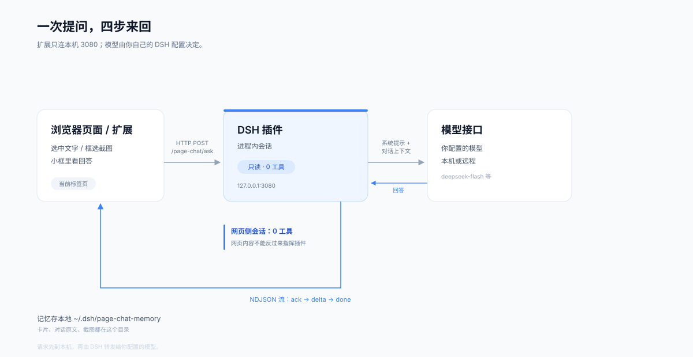

# 随手问

**网页上划一句，顺手问一下你的本地 AI。**

随口一句，它接得住。

[](LICENSE)
[](extension/manifest.json)
[](#兼容性)


> 上图是手绘的界面示意，不是截图。

## 你大概也这样问过

选中一句话，`Ctrl+C`，切到聊天窗口，粘贴，问，再切回来。  
六个动作，只为了问一句「这什么意思」。  
随手问把六个动作压成一个：划一句，点一下，答案就在原地。

## 三个入口

- **划词浮标**：在普通网页里选中 2 个字以上，选区右下角会冒出「随手问」小胶囊；点它，小框带着原文打开。
- **右键菜单**：选中文字后右键「随手问这段」；也可以在页面任意处右键「框选一块截图随手问」，拉一个框，图就放进小框里。
- **工具栏图标**：点浏览器工具栏上的扩展图标，在当前标签页唤起小框。它不主动抓选区；如果页面上还留着选中的字，会顺手带上，否则就是一个空输入框。

> 小框不会自动读整页。它看见的只有你选中的文字、框选的截图，和你亲手打进去的问题。

## 特性

| 特性 | 一句话 |
| --- | --- |
| 多轮记忆 | 同一标签页里连着问，它记得前面聊过什么，最多 20 轮；关掉标签页就清空。 |
| 记住这段 | 点一下，把这段对话压成一张记忆卡；5 秒内再点一下就能撤销。 |
| 截图提问 | 框选页面任意一块，图放进小框，再写一句问题一起发；图表、报错框都能截。 |
| 只读闸门 | 网页侧会话被限制成 0 个工具，只能回答；不能读文件、跑命令，也不能反过来指挥 DSH。 |
| 答案渐显 | 回答像打字一样逐字铺开，不是整段砸出来；实际开始时间取决于模型。 |
| 主会话可查 | DSH 主会话能用 `memory_search` 按站点和关键词翻卡，用 `memory_open` 看原文。 |
| 存成看板卡 | 点一下，把这段对话连同来源链接丢进 DSH 的看板，变成一张待办卡（需要另装看板插件）。 |
| 一份源码两处用 | Chrome 系吃 MV3；Firefox/Zen 用 `node build-firefox.mjs` 从同一份源码组出 MV2 包。 |
| 全本地 | 没有作者的中转服务器，记忆落在本机；模型是不是本地，取决于你配的接口。 |

## 安装

三步。每步都有一句「怎么确认成功」。

### ① 先让 DSH 跑起来

需要 Node.js 24.9+ 和 DSH 0.2.2+。

```powershell
npm i -g @deepseek-ai/dsh
dsh web
```

浏览器打开 `http://127.0.0.1:3080`，能看到 DSH 的页面就算成功。这个地址也是扩展默认连接的地址。

### ② 装后端插件

插件本体在仓库的 `plugin/` 目录（包名 `@pydsl/dsh-page-chat`，版本 0.2.0）。把它挂进 DSH 的 `web` profile。

**1. 在 profile 的 `package.json` 里加依赖**

编辑 `~/.dsh/profiles/web/package.json`，在 `dependencies` 里加一行，路径换成你本机的绝对路径：

```json
"@pydsl/dsh-page-chat": "file:D:/path/to/suishouwen/plugin"
```

**2. 建目录联接**

在 profile 的 `node_modules/@pydsl/` 下建一个联接（junction，可以理解成给目录开一个快捷方式），指向同一个 `plugin/` 目录：

```powershell
$profileDir = "$HOME\.dsh\profiles\web"
New-Item -ItemType Directory -Force "$profileDir\node_modules\@pydsl" | Out-Null
New-Item -ItemType Junction `
  -Path "$profileDir\node_modules\@pydsl\dsh-page-chat" `
  -Target "D:\path\to\suishouwen\plugin"
```

**3. 在 `cordis.patch.yml` 里挂上插件**

编辑 `~/.dsh/profiles/web/cordis.patch.yml`，insert 一条。仓库里的 `plugin/cordis.patch.yml` 可以直接照抄：

```yaml
- insert:
    - id: page-chat
      name: '@pydsl/dsh-page-chat'
      config:
        memoryDir: !!js dshHomePath('page-chat-memory')
        maxTurns: 20
```

**4. 重启 `dsh web`。**

**怎么确认成功**：打开 `http://127.0.0.1:3080/page-chat/health`，应该看到类似：

```json
{ "ok": true, "dshReady": true, "version": "0.2.0" }
```

`sessions` 和 `now` 每次会变；`ok`、`dshReady`、`version` 对得上就行。

### ③ 装扩展

**Chrome / Edge / Brave**

1. 打开 `chrome://extensions`。
2. 右上角打开「开发者模式」。
3. 点「加载已解压的扩展程序」，选仓库里的 `extension/` 目录。

**Firefox / Zen**

1. 在仓库根目录运行 `node build-firefox.mjs`，它会生成 `_dist-firefox/`。
2. 打开 `about:debugging#/runtime/this-firefox`。
3. 点「临时载入附加组件」，选 `_dist-firefox/manifest.json`。

**怎么确认成功**：在普通网页里选中 2 个字以上，选区右下角出现「随手问」浮标；点开小框，问一句，能收到回答。Firefox/Zen 的临时扩展在重启浏览器后会消失，要重新载入。

## 它怎么工作



1. 你在页面上选中文字或框选一块，扩展把这段内容和问题打包。
2. 扩展向本机 `http://127.0.0.1:3080/page-chat/ask` 发一个 POST。
3. DSH 插件在自己的进程里开一个只读会话，把系统提示、你选中的内容和这段对话交给模型；网页侧会话没有任何工具权限。
4. 插件把回答按 NDJSON（一行一个 JSON 小包）写回：`ack` → `delta` → `done`；扩展收完这一串，再在小框里逐字铺开。

## 隐私

- **默认不收集任何数据**：没有账号，没有埋点，没有作者服务器。
- **会发出去的内容**：你选中的文字、框选的截图、你打的问题。它们先到本机 `127.0.0.1:3080`，再由 DSH 发给你配置的模型接口。模型跑在本地，就只在本机转。
- **记忆存在本机**：`~/.dsh/page-chat-memory/`，包括卡片、对话原文和截图。扩展自己只在当前标签页的 `sessionStorage` 里记会话号和面板位置，关掉标签页就没。
- **没有官方云**：可选的云同步要你自己开，走你的 GitHub 私有仓库或 WebDAV；令牌明文存在本机配置里，能读那个文件的人就能读令牌。

细节见 [隐私说明](docs/PRIVACY.md)。

## 兼容性

| 浏览器 | 清单 | 状态 | 说明 |
| --- | --- | --- | --- |
| Chrome / Edge / Brave | MV3 | 可用 | 直接「加载已解压」`extension/` |
| Firefox / Zen | MV2 | 可用（临时载入） | 先 `node build-firefox.mjs`；要求 Firefox 142+ |
| Safari | — | 暂不支持 | 需要单独打包和签名，仓库里没有 |

Firefox/Zen 的临时扩展重启浏览器就掉，这是临时载入本身的限制，不是插件坏了。

## 已知限制

1. Firefox/Zen 的临时扩展重启浏览器就掉；Chrome 的已解压扩展一般会留着，但换目录或改文件后可能要重新加载。
2. 会话按标签页分开：每个标签页各聊各的，关掉标签页这段对话就没了；想在同一页重开，点小框里的「新对话」。
3. 回答不是网络逐字流：扩展会等这一轮 NDJSON 收完，再在小框里逐字铺开；很长的回答，前期要等。
4. 记忆卡不会自动进网页小框；网页会话看不到卡，也调不了记忆工具。旧卡由 DSH 主会话用 `memory_search` 按站点和关键词查，用 `memory_open` 看原文；不是向量检索。
5. 不自动读整页：只看见你选中的文字、框选的截图，和你亲手打的问题。
6. 「存成看板卡」要另装看板插件（`@pydsl/dsh-board-plugin`，本仓库不含）；没装时点它会提示「看板插件没装或没开」，其余功能不受影响。
7. Windows 为主，macOS/Linux 没测过。

## License

MIT。见 [LICENSE](LICENSE)。

这是个人项目，欢迎 issue；不承诺响应时间。
