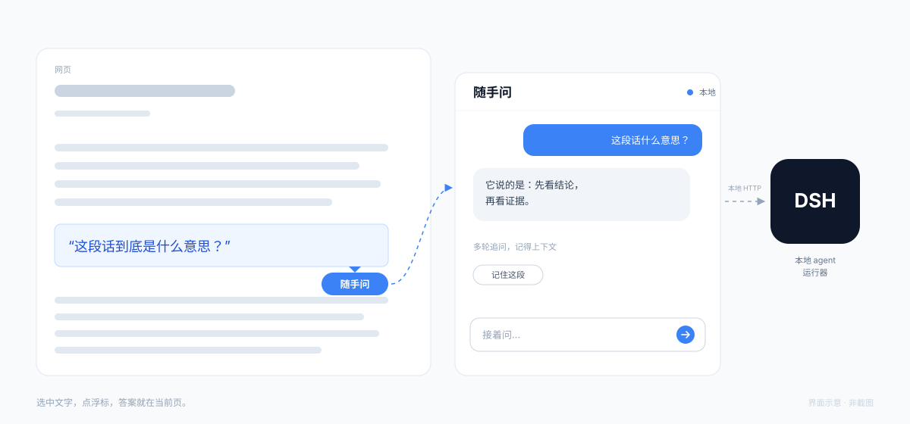

# 随手问

**网页上划一句，顺手问一下你的本地 AI。**

随口一句，它接得住。

[](LICENSE)
[](extension/manifest.json)
[](#兼容性)




> 上图是手绘的界面示意，不是截图。

## 你大概也这样问过

选中一句话，`Ctrl+C`，切到聊天窗口，粘贴，问，再切回来。  
六个动作，只为了问一句「这什么意思」。  
随手问把六个动作压成一个：划一句，点一下，答案就在原地。

## 三个入口

- **划词浮标**：在普通网页里选中 2 个字以上，选区右下角会冒出「随手问」小胶囊；点它，小框带着原文打开。
- **右键菜单**：选中文字后右键「随手问这段」；也可以在页面任意处右键「框选一块截图随手问」，拉一个框，图就放进小框里。
- **工具栏图标**：点浏览器工具栏上的扩展图标，在当前标签页唤起小框。它不主动抓选区；如果页面上还留着选中的字，会顺手带上，否则就是一个空输入框。

> 小框不会自动读整页。它看见的只有你选中的文字、框选的截图，和你亲手打进去的问题。

## 特性

| 特性 | 一句话 |
| --- | --- |
| 多轮记忆 | 同一标签页里连着问，它记得前面聊过什么，最多 20 轮；关掉标签页就清空。 |
| 记住这段 | 点一下，把这段对话压成一张记忆卡；5 秒内再点一下就能撤销。 |
| 截图提问 | 框选页面任意一块，图放进小框，再写一句问题一起发；图表、报错框都能截。 |
| 只读闸门 | 网页侧会话被限制成 0 个工具，只能回答；不能读文件、跑命令，也不能反过来指挥 DSH。 |
| 答案渐显 | 回答像打字一样逐字铺开，不是整段砸出来；实际开始时间取决于模型。 |
| 主会话可查 | DSH 主会话能用 `memory_search` 按站点和关键词翻卡，用 `memory_open` 看原文。 |
| 存成看板卡 | 点一下，把这段对话连同来源链接丢进 DSH 的看板，变成一张待办卡（需要另装看板插件）。 |
| 一份源码两处用 | Chrome 系吃 MV3；Firefox/Zen 用 `node build-firefox.mjs` 从同一份源码组出 MV2 包。 |
| 全本地 | 没有作者的中转服务器，记忆落在本机；模型是不是本地，取决于你配的接口。 |

## 安装

三种走法，从省事到好奇：让 AI 助手读安装单、自己跑一条命令、或者手动一步一步来。

### ⓪ 直接下装好的包

扩展已经由 Mozilla 签过名，不用自己编译：

- **Firefox / Zen**：[`suishouwen-0.4.5-firefox-signed.xpi`](https://github.com/pydsl43/suishouwen/releases/latest/download/suishouwen-0.4.5-firefox-signed.xpi) → 打开 `about:addons` → 右上角齿轮 → **从文件安装附加组件** → 选它。装完就在扩展列表里，重启浏览器不用重新加载。
- **Chrome / Edge / Brave**：[`suishouwen-0.4.5-chrome.zip`](https://github.com/pydsl43/suishouwen/releases/latest/download/suishouwen-0.4.5-chrome.zip) → 解压 → `chrome://extensions` → 开发者模式 → 加载已解压的扩展程序 → 选解压出来的文件夹。

校验和在同页的 `SHA256SUMS.txt` 里。

**但扩展只是个空壳**：它要连上本机的 DSH 插件才有脑子。所以第一次装还是要往下走 ①或②（装插件），扩展本身这两步就能装好。

### ① 把它交给你的 AI 助手（推荐）

把下面这段原样丢给你的 AI 助手（能在这台机器上跑命令的都行）：

> 帮我装 https://github.com/pydsl43/suishouwen ：读 INSTALL.md，按里面装后端，装完访问 http://127.0.0.1:3080/page-chat/health 确认，再告诉我在浏览器里怎么加载扩展。

它会 clone 仓库、跑 `scripts/install.ps1`、把 health 的结果贴给你，最后告诉你浏览器里点哪儿。整个过程只动 DSH 的 `web` profile，出问题能一条命令回滚。

前置条件还是那两样：Node.js 24.9+，和 DSH 0.2.2+ 且至少跑过一次（`~/.dsh/profiles/web/` 存在）。

### ② 或者自己跑一条命令

```powershell
git clone https://github.com/pydsl43/suishouwen
cd suishouwen
powershell -ExecutionPolicy Bypass -File .\scripts\install.ps1 -DryRun   # 先看它要做什么，不落盘
powershell -ExecutionPolicy Bypass -File .\scripts\install.ps1            # 真装
```

这一条把原来的三步一次做完：写依赖、建目录联接、往 `cordis.patch.yml` 追加那段配置。重复跑不会重复插入；动任何文件前先备份到 `~/.dsh/.backup-page-chat-<时间戳>/`。

装完打开 `http://127.0.0.1:3080/page-chat/health`，看到 `{"ok":true,"dshReady":true,"version":"0.2.0"}` 就成了。

**扩展这块，两条路**：Firefox / Zen 直接下①里的签名包，`about:addons` → 齿轮 → 从文件安装，一次装好、重启还在；Chrome / Edge / Brave 解压 zip → `chrome://extensions` → 开发者模式 → 加载已解压的扩展程序。想在命令行里多要一步，仓库里有 `scripts/install-extension.ps1`：它会打开对的页面、把路径塞进剪贴板，然后轮询等扩展连上，装好了直接告诉你。装完访问 `http://127.0.0.1:3080/page-chat/installed` 也能自检：看到 `installed:true` 与版本号就是真装上了。

**怎么确认成功**：普通网页里选中 2 个字以上，选区右下角出现「随手问」浮标；点开问一句，能收到回答。

装不上看 [`docs/INSTALL-FAQ.md`](docs/INSTALL-FAQ.md)；想撤就 `powershell -ExecutionPolicy Bypass -File .\scripts\uninstall.ps1`，它会清干净并告诉你记忆目录在哪。

### ③ 手动装（想搞清楚每一步）

想看清每步到底改了什么，就照这个顺序来。细节、参数、排错都在 [`INSTALL.md`](INSTALL.md)。

1. **让 DSH 先跑起来**：`npm i -g @deepseek-ai/dsh`，然后 `dsh web`，浏览器能打开 `http://127.0.0.1:3080`。
2. **在 profile 的 `package.json` 里加依赖**：`"@pydsl/dsh-page-chat": "file:D:/path/to/suishouwen/plugin"`（换成你本机的绝对路径）。
3. **建目录联接**：`profiles/web/node_modules/@pydsl/dsh-page-chat` 指向同一个 `plugin/` 目录，`New-Item -ItemType Junction` 一条命令。
4. **在 `cordis.patch.yml` 里 insert 一条**：`id: page-chat`、`name: '@pydsl/dsh-page-chat'`，config 照抄仓库里的 `plugin/cordis.patch.yml`。
5. **重启 `dsh web`**，再打开 `http://127.0.0.1:3080/page-chat/health` 确认。
6. **加载扩展**：步骤同上面 ② 的最后一段。

## 它怎么工作


1. 你在页面上选中文字或框选一块，扩展把这段内容和问题打包。
2. 扩展向本机 `http://127.0.0.1:3080/page-chat/ask` 发一个 POST。
3. DSH 插件在自己的进程里开一个只读会话，把系统提示、你选中的内容和这段对话交给模型；网页侧会话没有任何工具权限。
4. 插件把回答按 NDJSON（一行一个 JSON 小包）写回：`ack` → `delta` → `done`；扩展收完这一串，再在小框里逐字铺开。

## 隐私

- **默认不收集任何数据**：没有账号，没有埋点，没有作者服务器。
- **会发出去的内容**：你选中的文字、框选的截图、你打的问题。它们先到本机 `127.0.0.1:3080`，再由 DSH 发给你配置的模型接口。模型跑在本地，就只在本机转。
- **记忆存在本机**：`~/.dsh/page-chat-memory/`，包括卡片、对话原文和截图。扩展自己只在当前标签页的 `sessionStorage` 里记会话号和面板位置，关掉标签页就没。
- **没有官方云**：可选的云同步要你自己开，走你的 GitHub 私有仓库或 WebDAV；令牌明文存在本机配置里，能读那个文件的人就能读令牌。

细节见 [隐私说明](docs/PRIVACY.md)。

## 兼容性

| 浏览器 | 清单 | 状态 | 说明 |
| --- | --- | --- | --- |
| Chrome / Edge / Brave | MV3 | 可用 | 直接「加载已解压」`extension/` |
| Firefox / Zen | MV2 | 可用（临时载入） | 先 `node build-firefox.mjs`；要求 Firefox 142+ |
| Safari | — | 暂不支持 | 需要单独打包和签名，仓库里没有 |

Firefox/Zen 的临时扩展重启浏览器就掉，这是临时载入本身的限制，不是插件坏了。

## 已知限制

1. Firefox/Zen 的临时扩展重启浏览器就掉；Chrome 的已解压扩展一般会留着，但换目录或改文件后可能要重新加载。
2. 会话按标签页分开：每个标签页各聊各的，关掉标签页这段对话就没了；想在同一页重开，点小框里的「新对话」。
3. 回答不是网络逐字流：扩展会等这一轮 NDJSON 收完，再在小框里逐字铺开；很长的回答，前期要等。
4. 记忆卡不会自动进网页小框；网页会话看不到卡，也调不了记忆工具。旧卡由 DSH 主会话用 `memory_search` 按站点和关键词查，用 `memory_open` 看原文；不是向量检索。
5. 不自动读整页：只看见你选中的文字、框选的截图，和你亲手打的问题。
6. 「存成看板卡」要另装看板插件（`@pydsl/dsh-board-plugin`，本仓库不含）；没装时点它会提示「看板插件没装或没开」，其余功能不受影响。
7. Windows 为主，macOS/Linux 没测过。

## License

MIT。见 [LICENSE](LICENSE)。

这是个人项目，欢迎 issue；不承诺响应时间。
